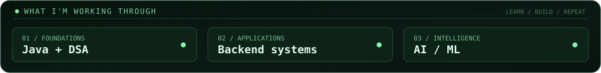
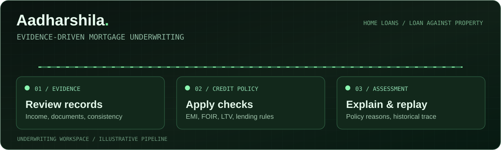

<!-- GitHub profile README: keep this file in the root of pushkkal0201-bit/pushkkal0201-bit. -->
<!-- The original animated Matrix portrait is kept in the repository root, unchanged. -->

  

  <h1>Hey, I'm Pushkkal.</h1>

  

    <strong>CSE (Artificial Intelligence) student</strong> · University of Lucknow 
    <strong>Intern</strong> · Dezinet Pvt. Ltd.
  

  
<em>Building things, breaking assumptions, and learning how the whole system fits together.</em>

  

    
    
    
    
  

  

    <a href="#a-little-about-me">About</a> &nbsp;·&nbsp;
    <a href="#currently-working-on-auralis">Current build</a> &nbsp;·&nbsp;
    <a href="#things-i-use-and-learn-with">Tech</a> &nbsp;·&nbsp;
    <a href="#other-things-im-exploring">More projects</a> &nbsp;·&nbsp;
    <a href="#github-activity">Activity</a>
  

  

## A little about me

I'm in my second year of CSE (Artificial Intelligence). I started out spending a lot of time with Java and DSA, and lately I've been getting more interested in how complete applications work — not just the algorithm, but the APIs, data, and decisions around it.

I like building a rough first version, figuring out why parts of it don't work, and improving it from there. Most of my projects are still evolving, and I prefer showing that process rather than pretending everything is finished.

<table>
  <tr>
    <td width="34%" valign="top">
      <strong>Now learning</strong> 
      Backend systems, AI/ML, and practical automation.
    </td>
    <td width="33%" valign="top">
      <strong>At work</strong> 
      Intern at Dezinet Pvt. Ltd.
    </td>
    <td width="33%" valign="top">
      <strong>One milestone</strong> 
      3rd place · college Code Sprint 2026.
    </td>
  </tr>
</table>

<strong>A bit more about how I build</strong>

I usually start with the smallest version I can test. Then I work through the less visible parts: how data moves, how an API responds when something goes wrong, and whether the result is actually useful. I care more about being able to explain a design choice than making a prototype look finished.

## Currently working on: Auralis

**[Auralis](https://github.com/pushkkal0201-bit/Auralis_Job_Search)** is where I'm exploring an AI-assisted job-search workflow: finding openings, assessing fit, and organizing the steps around an application.

<strong>See the workflow I'm exploring</strong>

1. **Find** relevant job openings.
2. **Assess** how an opening lines up with a candidate's experience.
3. **Organize** application preparation and the steps that follow.

The illustration above is a workflow visual, not a screenshot of a finished product.

## Things I use and learn with

| Programming | AI / data | Software & tooling |
| :--- | :--- | :--- |
| `Java` · `Python` · `C` · `JavaScript` | `OpenCV` · `NumPy` · `Pandas` · `scikit-learn` | `Git` · `GitHub` · `APIs` |

Not an exhaustive skill list — just the tools most relevant to the work I share here. Some are still part of my learning process.

## Other things I'm exploring

Beyond Auralis, I've worked on computer-vision experiments, including a Java/OpenCV attendance-system prototype. I'm also interested in systems design and understanding how small projects can become reliable applications.

**[Aadharshila](https://github.com/pushkkal0201-bit/AadharShila)** — an evidence-driven mortgage underwriting prototype for Home Loans and Loan Against Property. It brings eligibility calculations, evidence checks, policy decisions, and assessment history into one workflow.

<strong>Other experiments and interests</strong>

- **Computer vision:** a Java/OpenCV attendance-system prototype and other hands-on experiments.
- **Systems design:** understanding APIs, boundaries, failure handling, and how small apps become more reliable.
- **Industrial AI:** exploring time-series anomaly detection and edge inference.

## GitHub activity

  

<!-- This animation is generated by the existing contribution-snake workflow on the output branch. -->

  

---

  
I occasionally write about what I'm learning, too: <a href="https://medium.com/@pushkkalgupta"><strong>Medium</strong></a>.

  
If you have feedback on a project, feel free to <a href="mailto:pushkkal0201@gmail.com">reach out</a>.

  Built to be read on GitHub: links, expandable sections, and self-contained SVG illustrations. No scripts required.

