<!-- START: CHATGPT ASCII CARD -->

<!-- END: CHATGPT ASCII CARD -->
<!--
╔══════════════════════════════════════════════════════════╗
  PUSHKKAL GUPTA / NEURAL TERMINAL
  Theme: Neo Noir
  Background: 070B14
  Primary: 00E5FF
  Secondary: FF2BD6
  Accent: A78BFA
╚══════════════════════════════════════════════════════════╝
-->

 

 

  

  

**`CURIOSITY → EXPERIMENTATION → UNDERSTANDING → CREATION`**

---

## â—ˆ Identity

<table>
<tr>
<td width="60%" valign="top">

### Pushkkal Gupta
**Technology enthusiast · Curious builder · Future focused**

I’m interested in the space where software, intelligent systems, and thoughtful design meet.

My approach is to explore ideas, understand the systems behind them, and turn what I learn into something useful.

- 🧠 **Explore:** AI, machine learning, and data.
- ⚙️ **Build:** Software and connected experiences.
- 🎨 **Design:** Interfaces with clarity and character.
- 🔁 **Improve:** Through practice and iteration.

</td>
<td width="40%" valign="top">

### Profile coordinates

**GitHub**  
[@pushkkal0201-bit](https://github.com/pushkkal0201-bit)

**Instagram**  
[@its.pushkkal](https://www.instagram.com/its.pushkkal/)

**Medium**  
[@pushkkalgupta](https://medium.com/@pushkkalgupta)

**Email**  
[pushkkal0201@gmail.com](mailto:pushkkal0201@gmail.com)

**LinkedIn**  
[Pushkkal Gupta](https://www.linkedin.com/in/pushkkal-gupta-1410b6407/)

</td>
</tr>
</table>

---

## â—ˆ Technology Matrix

> Languages, frameworks, platforms, and creative tools in my technology toolkit.

### 01 / Programming Languages

### 02 / Frontend, Interfaces & Visualization

### 03 / Backend & Event Streaming

### 04 / Artificial Intelligence & Data Science

### 05 / Databases & Backend Platforms

### 06 / Cloud, Hosting & Deployment

### 07 / Design & Creative Tools

### 08 / Version Control & Hardware

---

## â—ˆ Development Telemetry

  

  

---

## â—ˆ Contribution Circuit

**`ONE CONTRIBUTION AT A TIME. ONE ITERATION FURTHER.`**

 

<!-- This image appears after the contribution-snake workflow succeeds. -->

Animation generated from the contribution calendar and refreshed daily.

---

## â—ˆ Repository Explorer

  

Ideas, experiments, and progress—follow the work as it evolves.

---

## â—ˆ Communication Channels

<!-- MASTODON:
Your original link used "Pushkkal Gupta" as the account handle.
Replace YOUR_HANDLE below with your actual Mastodon username,
then remove the surrounding comment.

-->

---

## â—ˆ Signal of the Day

  

**`END OF TRANSMISSION / NEXT ITERATION PENDING`**

